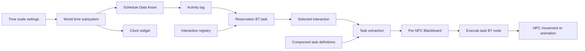

# Architecture

[Documentation index](README.md)

## Module boundaries

| Module | Type | Responsibility |
| :--- | :--- | :--- |
| `SimulationWord` | Runtime | Schedule evaluation, interaction lookup and reservations, NPC task execution, world time, and clock UI. |
| `SimulationWordEditor` | Editor | Viewport visualization and editing of movement destinations. Loads at `PostEngineInit`. |

The runtime module uses `AIModule`, `GameplayTags`, `DeveloperSettings`, and UMG/Slate alongside Unreal's core and engine modules. Editor dependencies are declared in the separate editor module.

## Main components

| Type | Responsibility |
| :--- | :--- |
| `UWorldTimeSubsystem` | Maintains simulation time as an `FTimespan` and advances it from world tick delta. |
| `USimulationWorldSettings` | Exposes the configured time scale through Project Settings and Game config. |
| `UScheduleTemplateDataAsset` | Resolves the activity tag from a sorted daily schedule. |
| `ABaseNPC` | Holds the NPC's schedule and provides the character used by interaction tasks. |
| `ABaseAiController` | Stores the possessed NPC and starts its configured Behavior Tree from `BeginPlay()`. |
| `USmartInteractionSubsystem` | Indexes registered interaction components by Gameplay Tag. |
| `USmartInteractionComponent` | Holds the interaction tag, capacity, worker reservations, and editable task definitions. |
| `UNPCBlackboardData` | Defines the selected interaction, runtime task data, and current task index. |
| `UBasedInteractionTask` | Defines the reusable execution lifecycle and completion event. |
| `UWorldTimeWidget` | Displays the clock string through a Blueprint-provided TextBlock. |

## Data flow



The Behavior Tree is responsible for control flow: when to reserve an object, when to extract its tasks, and when to re-enter the execution cycle. Subsystems provide time and lookup services; they do not run NPC tasks.

## Daily schedule evaluation

`GetActivationTagAtTime()` reduces the supplied `FTimespan` to hours, minutes, and seconds, so activities repeat daily regardless of elapsed days.

The algorithm:

1. Returns `FGameplayTag::EmptyTag` for an empty schedule.
2. Starts with the final activity as the fallback before today's first entry.
3. Scans entries in ascending start-time order.
4. Stops at the first entry later than the current time.
5. Returns the most recent entry whose start time has passed.

An activity becomes active at its exact start time. Entries must already be sorted; lookup does not sort them. Equal start times resolve to the last matching entry in array order.

Tag matching uses exact equality. `Interaction.Work` and `Interaction.Work.Factory` are different lookup keys.

## Registration and selection

`USmartInteractionComponent::InitializeComponent()` registers the component with the world subsystem. The registry stores a map from tags to arrays of weak component references.

`FindAppropriateSmartObject()` scans the array for the requested tag and returns the first valid component for which `IsComponentAccessible()` is true. Availability currently means:

```cpp
Workers.Num() < MaxWorkers
```

Selection uses registration order. It does not compare distance, path cost, visibility, or NPC preferences. The controller's sight perception configuration does not participate in this lookup.

## Reservation transition

Once its controller, NPC, schedule, clock, Blackboard, and interaction subsystem have passed validation, `UBTTask_ReserveSmartInteraction` performs this transition:

1. Removes the NPC from the previously selected component's worker array.
2. Clears `SelectedInteraction`.
3. Writes empty `ExecutionTasks` data and sets `CurrentTaskIndex` to zero.
4. Searches for an available component with the scheduled tag.
5. Adds the NPC to that component's workers and writes it to Blackboard.

The old reservation is released before lookup. If no replacement exists, the node returns `Failed`; it does not restore the previous reservation. Validation failures before the release step leave the previous state unchanged.

`ReserveSmartObject()` uses `AddUnique()` and `ReleaseSmartObject()` removes only the supplied NPC. Capacity is checked by lookup, not inside the reservation method itself. Direct callers must respect that contract.

## Ownership and runtime isolation

| Reference | Storage | Purpose |
| :--- | :--- | :--- |
| Component task definitions | `UPROPERTY(Instanced)` array of `TObjectPtr` | Editable actions shared as definitions by users of the object. |
| Registry entries | `TWeakObjectPtr<USmartInteractionComponent>` | Lookup without keeping interaction actors alive. |
| Worker reservations | `TWeakObjectPtr<AActor>` | Tracks participating actors without owning them. |
| Runtime tasks | Reflected `TObjectPtr` array inside `FExecutionTasksData` | Keeps each NPC's extracted task objects referenced. |
| Task pawn | Transient, duplicate-transient weak pointer | Identifies the current executor without retaining it. |
| Active BT task reference | Transient, duplicate-transient `TObjectPtr` | Holds the task while its BT node waits for completion. |

Unreal's native Struct Blackboard key instances keys containing strong object references so those references participate in GC. The reflected task array provides those references; the UObject Outer relationship alone is not the retention mechanism described here.

New duplicates are created during extraction. Index wraparound reuses the existing runtime task objects after reset.

## Source references

- [World time implementation](../Source/SimulationWord/Private/Core/Subsystems/WorldTimeSubsystem.cpp)
- [Schedule lookup](../Source/SimulationWord/Private/DataAssets/ScheduleTemplateDataAsset.cpp)
- [Interaction registry](../Source/SimulationWord/Private/Core/Subsystems/SmartInteractionSubsystem.cpp)
- [Interaction component](../Source/SimulationWord/Private/Core/Components/SmartInteractionComponent.cpp)
- [Reservation task](../Source/SimulationWord/Private/NPCS/BehaviorTree_Tasks/BTTask_ReserveSmartInteraction.cpp)

Continue with [runtime execution](runtime-execution.md).
